# 真实页面 / Live product screenshots

拍摄于 2026-10-15，公司运行环境。以下是实际页面，不是设计稿；为避免展示私人项目列表，首页和美林截图仅保留功能区域。其余工程为验收示例，历史状态如实保留。界面会随账号权限、模型目录和后续版本变化。

Captured from the running product on October 15, 2026. These are real interfaces, not mockups. Home and Meilin captures exclude private project lists. Other projects are QA examples, including their existing historical states. Available controls depend on permissions and model configuration.

## 超级创作 / Create

动态小球、创作模式、参考内容、模型与规格、右上历史对话。灵感和最近画布位于下方。

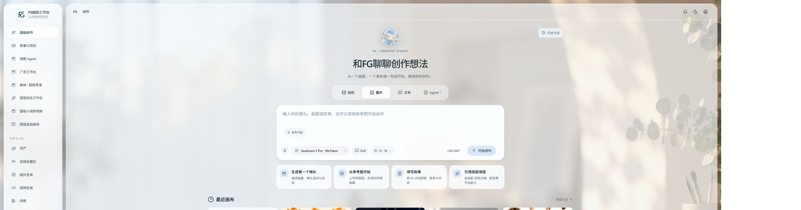

## 图片工作台 / Image workbench

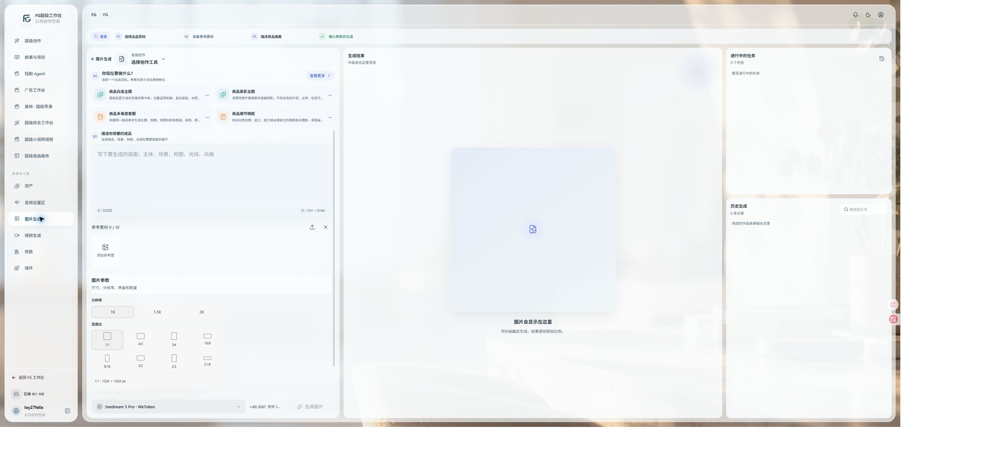

## 视频工作台 / Video workbench

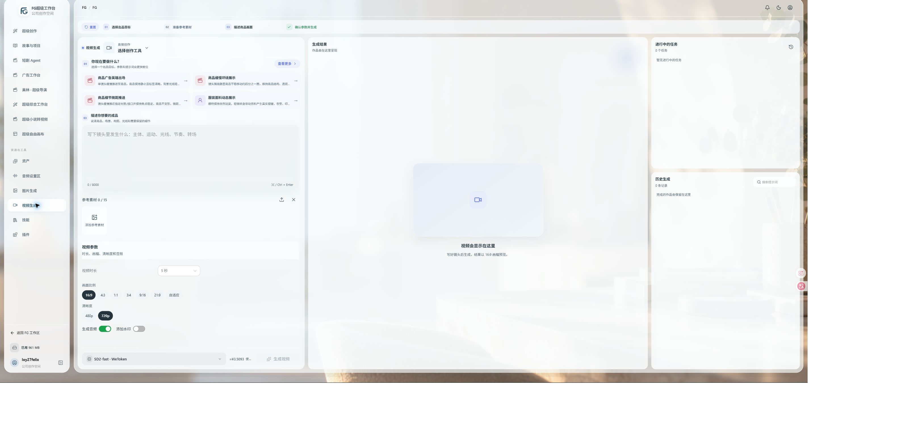

## 美林 / Meilin

一句话开始，或从已有剧本直接制作。

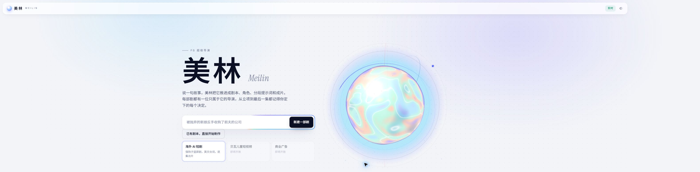

## 自由画布 / Free canvas

验收示例：文本、图片与视频节点的参考关系。

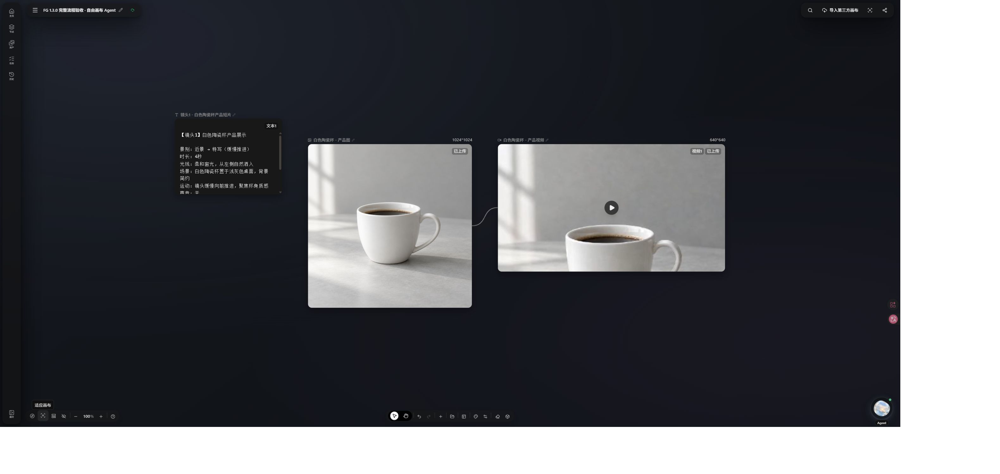

## 灵感星球 / Inspiration planet

全屏环顾、类型与分类筛选；截图中的公开素材保留原来源与许可。

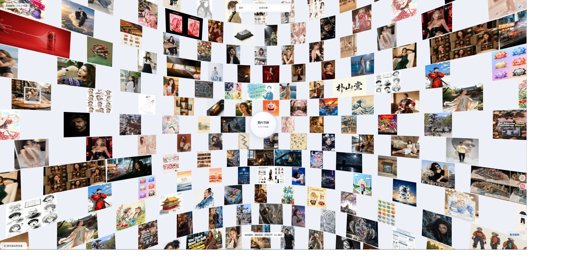

## 短剧工程 / Short-drama project

章节、镜头、资产和制作进度集中管理。

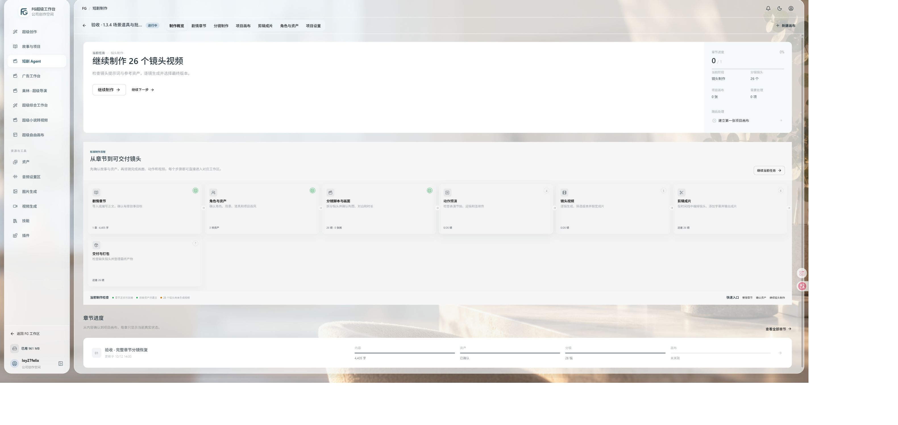

## 镜头制作 / Shot production

提示词、参考素材、产物与版本集中查看。

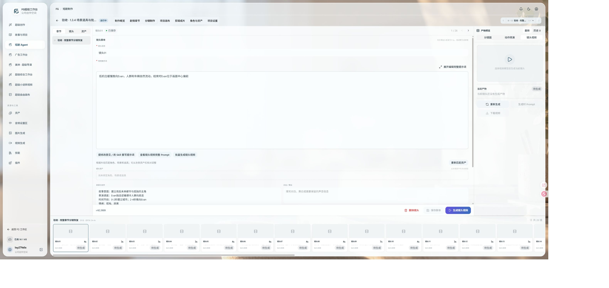

## 广告工程 / Advertising project

验收工程的素材节点与 Agent 工作区；截图保留已有任务状态，并非所有任务成功的声明。

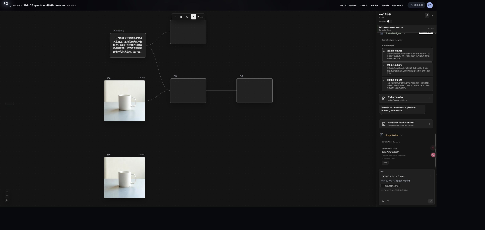

## 音频设置 / Audio tools

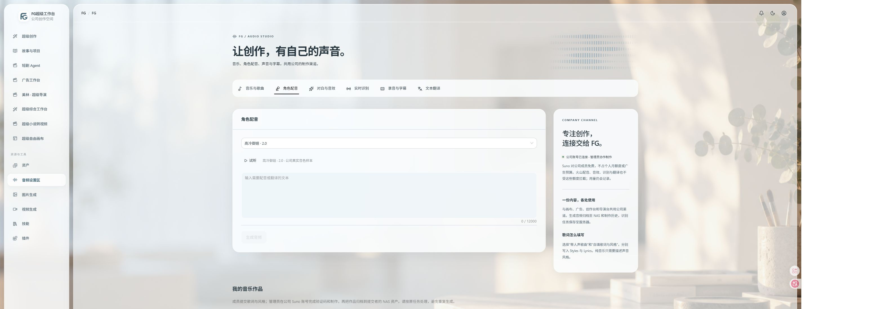

## 技能中心 / Skills

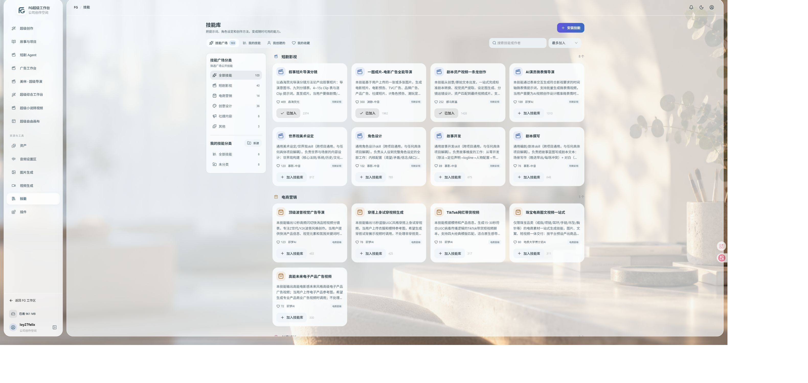

[中文介绍](../../README.md) · [English overview](../../README.en.md)
